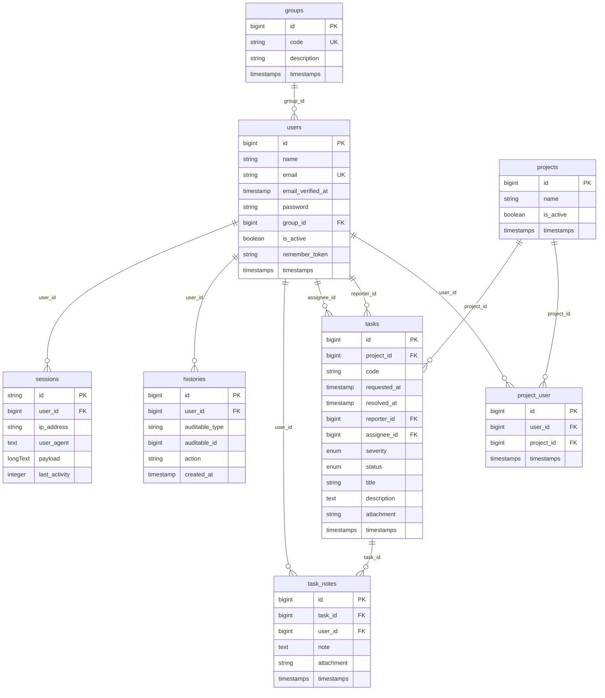

# Estrutura do banco de dados

Schema PostgreSQL do **Chamados.TI** (Laravel 10). Fonte de verdade: migrations em `database/migrations/`.

## Visão geral

| Tabela | Papel |
|--------|--------|
| `groups` | Perfis de acesso (`ADMIN`, `SUPORTE`, `USUARIOS`) |
| `users` | Usuários do sistema |
| `projects` | Projetos / áreas de atendimento |
| `project_user` | Vínculo N:N usuário ↔ projeto |
| `tasks` | Chamados / solicitações |
| `task_notes` | Anotações e anexos das tarefas |
| `histories` | Auditoria polimórfica de ações |
| `sessions` | Sessões web (`SESSION_DRIVER=database`) |

## Diagrama ER



## Tabelas

### `groups`

| Coluna | Tipo | Restrições | Descrição |
|--------|------|------------|-----------|
| `id` | bigint | PK | Identificador |
| `code` | string | unique | Código do perfil (`ADMIN`, `SUPORTE`, `USUARIOS`) |
| `description` | string | | Nome legível |
| `created_at` / `updated_at` | timestamps | | |

Dados obrigatórios inseridos na migration `2026_07_07_000004_seed_groups`.

### `users`

| Coluna | Tipo | Restrições | Descrição |
|--------|------|------------|-----------|
| `id` | bigint | PK | Identificador |
| `name` | string | | Nome |
| `email` | string | unique | E-mail de login |
| `email_verified_at` | timestamp | nullable | |
| `password` | string | | Hash da senha |
| `group_id` | bigint | FK → `groups.id`, `restrictOnDelete` | Perfil |
| `is_active` | boolean | default `true` | Login permitido se ativo |
| `remember_token` | string | nullable | |
| `created_at` / `updated_at` | timestamps | | |

Admin padrão (`admin@admin.com`) criado na migration `2026_07_07_000003_seed_admin_user`.

### `projects`

| Coluna | Tipo | Restrições | Descrição |
|--------|------|------------|-----------|
| `id` | bigint | PK | Identificador |
| `name` | string | | Nome do projeto |
| `is_active` | boolean | default `true` | |
| `created_at` / `updated_at` | timestamps | | |

### `project_user`

Pivot N:N entre usuários e projetos.

| Coluna | Tipo | Restrições | Descrição |
|--------|------|------------|-----------|
| `id` | bigint | PK | Identificador |
| `user_id` | bigint | FK → `users.id`, `cascadeOnDelete` | |
| `project_id` | bigint | FK → `projects.id`, `cascadeOnDelete` | |
| `created_at` / `updated_at` | timestamps | | |

Unique composto: `(user_id, project_id)`.

### `tasks`

| Coluna | Tipo | Restrições | Descrição |
|--------|------|------------|-----------|
| `id` | bigint | PK | Identificador |
| `project_id` | bigint | FK → `projects.id`, `cascadeOnDelete` | Projeto |
| `code` | string | unique com `project_id` | Código do chamado |
| `requested_at` | timestamp | | Data da solicitação |
| `resolved_at` | timestamp | nullable | Preenchido ao resolver |
| `reporter_id` | bigint | FK → `users.id`, `restrictOnDelete` | Solicitante |
| `assignee_id` | bigint | FK → `users.id`, nullable, `nullOnDelete` | Responsável |
| `severity` | enum | `low`, `medium`, `high`, `critical` | Gravidade |
| `status` | enum | `open`, `in_progress`, `resolved`, `closed` | Status |
| `title` | string | | Título |
| `description` | text | | Descrição |
| `attachment` | string | nullable | Caminho do anexo em `storage` |
| `created_at` / `updated_at` | timestamps | | |

**Código sequencial:** na aplicação o próximo `code` é gerado de forma **global** (máximo entre todas as tarefas + 1), não reinicia por projeto. A constraint unique `(project_id, code)` permanece no banco.

Fluxo de status: `open` → `in_progress` → `resolved` → `closed`.

### `task_notes`

| Coluna | Tipo | Restrições | Descrição |
|--------|------|------------|-----------|
| `id` | bigint | PK | Identificador |
| `task_id` | bigint | FK → `tasks.id`, `cascadeOnDelete` | Tarefa |
| `user_id` | bigint | FK → `users.id`, `restrictOnDelete` | Autor |
| `note` | text | | Texto da anotação |
| `attachment` | string | nullable | Anexo |
| `created_at` / `updated_at` | timestamps | | |

### `histories`

Log de auditoria polimórfico (sem `updated_at`).

| Coluna | Tipo | Restrições | Descrição |
|--------|------|------------|-----------|
| `id` | bigint | PK | Identificador |
| `user_id` | bigint | FK → `users.id`, `restrictOnDelete` | Quem executou a ação |
| `auditable_type` | string | | Classe do modelo (`App\Models\Task`, etc.) |
| `auditable_id` | bigint | | ID do registro auditado |
| `action` | string | | `created`, `updated`, `deleted`, `assigned`, `resolved`, `closed` |
| `created_at` | timestamp | | Momento da ação |

Entidades auditadas na aplicação: usuários, projetos, tarefas e anotações.

### `sessions`

Armazena sessões do Laravel quando `SESSION_DRIVER=database`.

| Coluna | Tipo | Restrições | Descrição |
|--------|------|------------|-----------|
| `id` | string | PK | ID da sessão |
| `user_id` | bigint | nullable, index | Usuário autenticado |
| `ip_address` | string(45) | nullable | |
| `user_agent` | text | nullable | |
| `payload` | longText | | Dados serializados da sessão |
| `last_activity` | integer | index | Unix timestamp |

## Relacionamentos resumidos

```
groups 1 ── * users
users * ── * projects          (via project_user)
projects 1 ── * tasks
users 1 ── * tasks             (reporter / assignee)
tasks 1 ── * task_notes
users 1 ── * task_notes        (autor)
users 1 ── * histories
users 1 ── * sessions          (opcional)
histories * ── 1 auditable     (polimórfico)
```
