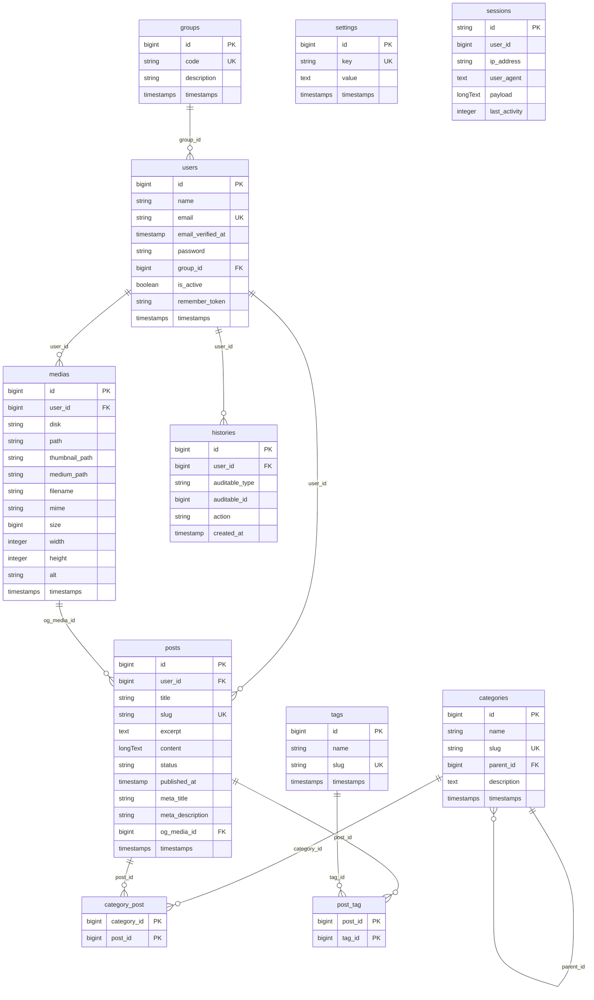

# Estrutura do banco de dados

Schema PostgreSQL do CMS (Laravel 10). Fonte de verdade: migrations em `database/migrations/`.

## Visão geral

| Tabela | Papel |
|--------|--------|
| `groups` | Perfil de acesso. A migration grava `ADMIN` |
| `users` | Usuários do painel |
| `categories` | Categorias do blog, com pai opcional |
| `tags` | Tags do blog |
| `medias` | Arquivos da biblioteca de mídia |
| `posts` | Posts do blog |
| `category_post` | Vínculo N:N post ↔ categoria |
| `post_tag` | Vínculo N:N post ↔ tag |
| `settings` | Configurações do site, uma linha por chave |
| `histories` | Auditoria polimórfica das ações |
| `sessions` | Sessões web (`SESSION_DRIVER=database`) |

## Diagrama ER



## Tabelas

### `groups`

| Coluna | Tipo | Restrições | Descrição |
|--------|------|------------|-----------|
| `id` | bigint | PK | Identificador |
| `code` | string | unique | Código do perfil |
| `description` | string | | Nome legível |
| `created_at` / `updated_at` | timestamps | | |

A migration `2026_07_07_000004_seed_groups` grava o grupo `ADMIN` (Administrador).

### `users`

| Coluna | Tipo | Restrições | Descrição |
|--------|------|------------|-----------|
| `id` | bigint | PK | Identificador |
| `name` | string | | Nome |
| `email` | string | unique | E-mail de login |
| `email_verified_at` | timestamp | nullable | |
| `password` | string | | Hash da senha |
| `group_id` | bigint | FK → `groups.id`, `restrictOnDelete` | Perfil |
| `is_active` | boolean | default `true` | Login permitido se ativo |
| `remember_token` | string | nullable | |
| `created_at` / `updated_at` | timestamps | | |

O usuário `admin@admin.com` é criado na migration `2026_07_07_000003_seed_admin_user`, no grupo `ADMIN`.

### `categories`

| Coluna | Tipo | Restrições | Descrição |
|--------|------|------------|-----------|
| `id` | bigint | PK | Identificador |
| `name` | string | | Nome |
| `slug` | string | unique | Identificador público |
| `parent_id` | bigint | nullable, FK → `categories.id`, `nullOnDelete` | Categoria pai |
| `description` | text | nullable | |
| `created_at` / `updated_at` | timestamps | | |

### `tags`

| Coluna | Tipo | Restrições | Descrição |
|--------|------|------------|-----------|
| `id` | bigint | PK | Identificador |
| `name` | string | | Nome |
| `slug` | string | unique | Identificador público |
| `created_at` / `updated_at` | timestamps | | |

### `medias`

Biblioteca de imagens. A tabela se chama `medias`.

| Coluna | Tipo | Restrições | Descrição |
|--------|------|------------|-----------|
| `id` | bigint | PK | Identificador |
| `user_id` | bigint | FK → `users.id`, `restrictOnDelete` | Quem enviou |
| `disk` | string | default `public` | Disco do Laravel |
| `path` | string | | Arquivo original |
| `thumbnail_path` | string | | Miniatura |
| `medium_path` | string | | Tamanho médio |
| `filename` | string | | Nome original |
| `mime` | string | | Tipo do arquivo |
| `size` | bigint | | Tamanho em bytes |
| `width` | integer | nullable | Largura |
| `height` | integer | nullable | Altura |
| `alt` | string | nullable | Texto alternativo |
| `created_at` / `updated_at` | timestamps | | |

### `posts`

| Coluna | Tipo | Restrições | Descrição |
|--------|------|------------|-----------|
| `id` | bigint | PK | Identificador |
| `user_id` | bigint | FK → `users.id`, `restrictOnDelete` | Autor |
| `title` | string | | Título |
| `slug` | string | unique | Identificador público |
| `excerpt` | text | nullable | Resumo |
| `content` | longText | nullable | HTML do editor |
| `status` | string | | `draft`, `published`, `scheduled` ou `trashed` |
| `published_at` | timestamp | nullable | Data de publicação |
| `meta_title` | string | nullable | Título de SEO |
| `meta_description` | string(320) | nullable | Descrição de SEO |
| `og_media_id` | bigint | nullable, FK → `medias.id`, `nullOnDelete` | Imagem de compartilhamento |
| `created_at` / `updated_at` | timestamps | | |

`status` é texto na aplicação, sem enum no banco. A lixeira também é um status: a exclusão física só ocorre quando o post já está `trashed`.

### `category_post`

Pivot N:N. Sem `id` e sem timestamps.

| Coluna | Tipo | Restrições | Descrição |
|--------|------|------------|-----------|
| `category_id` | bigint | PK, FK → `categories.id`, `cascadeOnDelete` | |
| `post_id` | bigint | PK, FK → `posts.id`, `cascadeOnDelete` | |

### `post_tag`

Pivot N:N. Sem `id` e sem timestamps.

| Coluna | Tipo | Restrições | Descrição |
|--------|------|------------|-----------|
| `post_id` | bigint | PK, FK → `posts.id`, `cascadeOnDelete` | |
| `tag_id` | bigint | PK, FK → `tags.id`, `cascadeOnDelete` | |

### `settings`

Uma linha por chave. O valor é texto, inclusive quando representa um id de mídia ou um número.

| Coluna | Tipo | Restrições | Descrição |
|--------|------|------------|-----------|
| `id` | bigint | PK | Identificador |
| `key` | string | unique | Chave |
| `value` | text | nullable | Valor |
| `created_at` / `updated_at` | timestamps | | |

Chaves usadas pela aplicação: `site_title`, `tagline`, `logo_media_id`, `posts_per_page`, `social_instagram`, `social_facebook`, `social_x`, `social_youtube`, `social_linkedin`, `social_github`, `social_email` e `tracking_code`. O padrão de `posts_per_page` é `10` enquanto a chave não foi salva. `logo_media_id` aponta para `medias.id` só como texto, sem chave estrangeira.

### `histories`

Log de auditoria polimórfico. Não tem `updated_at`.

| Coluna | Tipo | Restrições | Descrição |
|--------|------|------------|-----------|
| `id` | bigint | PK | Identificador |
| `user_id` | bigint | FK → `users.id`, `restrictOnDelete` | Quem executou a ação |
| `auditable_type` | string | | Classe do model |
| `auditable_id` | bigint | | ID do registro auditado |
| `action` | string | | `created`, `updated` ou `deleted` |
| `created_at` | timestamp | default agora | Momento da ação |

Índice composto em `(auditable_type, auditable_id)`.

A aplicação grava histórico de usuário, post, categoria, tag, mídia e configuração.

### `sessions`

Sessões do Laravel quando `SESSION_DRIVER=database`. `user_id` é indexado e pode ser nulo. Não há chave estrangeira para `users`.

| Coluna | Tipo | Restrições | Descrição |
|--------|------|------------|-----------|
| `id` | string | PK | ID da sessão |
| `user_id` | bigint | nullable, index | Usuário autenticado |
| `ip_address` | string(45) | nullable | |
| `user_agent` | text | nullable | |
| `payload` | longText | | Dados serializados da sessão |
| `last_activity` | integer | index | Unix timestamp |

## Relacionamentos resumidos

```
groups 1 ── * users
users 1 ── * posts
users 1 ── * medias
medias 1 ── * posts            (og_media_id, opcional)
categories 1 ── * categories   (parent_id, opcional)
posts * ── * categories        (via category_post)
posts * ── * tags              (via post_tag)
users 1 ── * histories
histories * ── 1 auditable     (polimórfico)
users 1 ── * sessions          (opcional, sem FK)
```
